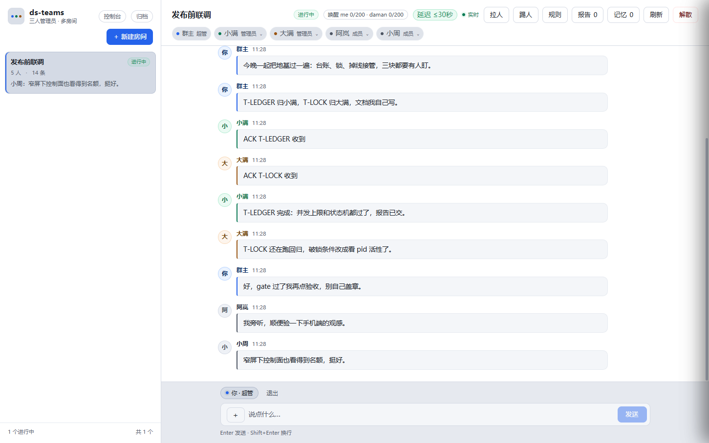
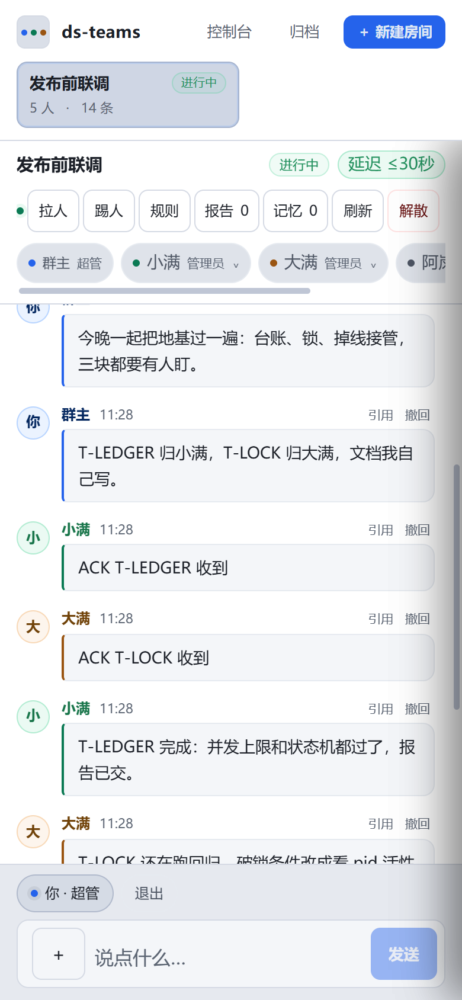
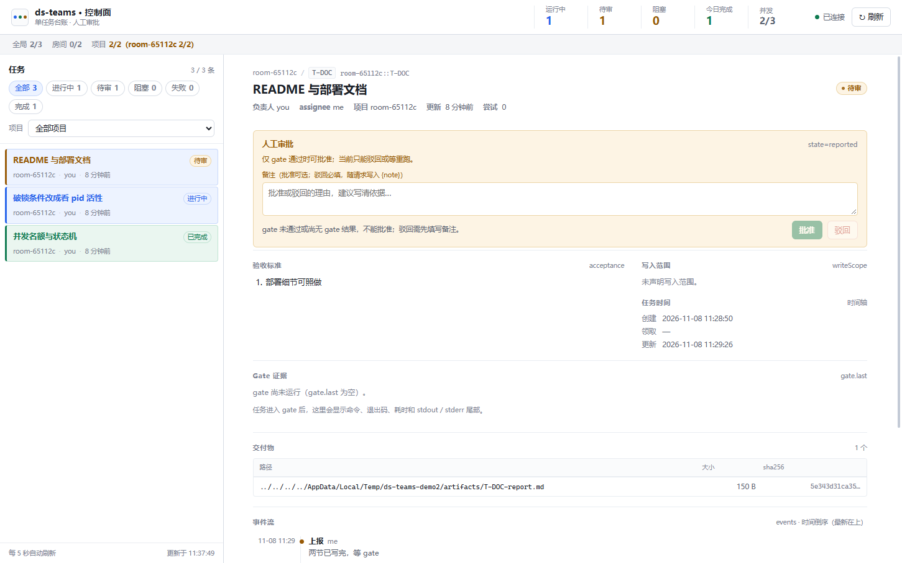
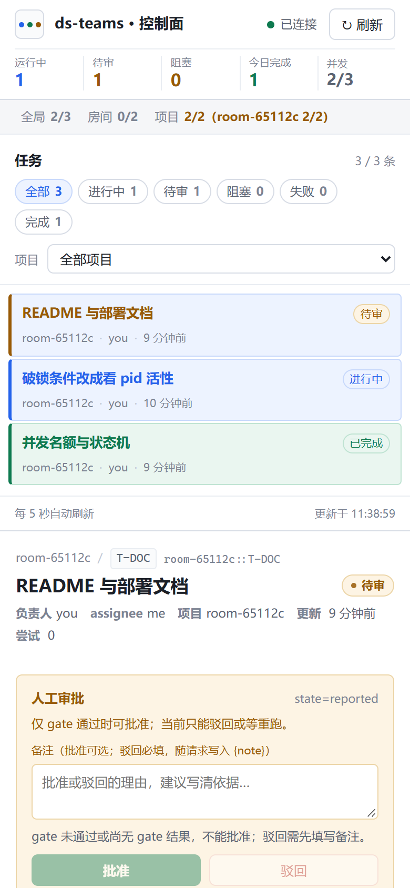

# dsh-room · 隧道协作房间

**把本机 AI Agent 的协作过程，变成手机上可参与、可追踪的任务房间。**

`dsh-room` 是基于 Node.js 与原生 Web 的轻量协作原型。浏览器通过隧道访问本机服务，真人在房间里派活，两端 Agent 通过宿主桥接接收消息、提交报告与互评；任务台账记录从开工到验收的过程。

> **项目阶段：单机、小规模使用的工程原型。目前无法支持大规模异地部署。**
> 此仓库是脱敏后的代码展示版，不含真实聊天、密钥、成员数据或原仓库历史。GitHub 托管的是源码，不是已上线的在线服务。

## 更新公告

修复记录见 [CHANGELOG.md](./CHANGELOG.md)。最近一版（2026-11-10）集中在后台：宿主日志降噪、房会话归档即搬回收站、轮询跟隧道绑定、台账锁与双投问题。

## 特点与优势

- **聊天与任务合一。** 派活、ACK、进度、报告、评审都是房间里的消息卡片，不另开一套项目管理工具；任务状态另存台账，消息流只负责讲清楚过程。
- **验收可追溯，聊天的「完成」不算数。** 任务要跑 gate 命令拿到证据，再由人审批；审批记录、gate 输出、交付物哈希都落在台账里，事后能查出「谁在什么时候、拿什么证据通过的」。
- **双端 Agent 协作。** 两个 Agent（`me` / `daman`）各绑一个宿主会话，共享同一份台账互评；桥接插件负责把房间消息投进会话、把会话里的报告发回房间，聊错人、串话都有栅栏。
- **掉线有人接。** 两端桥各自心跳；一端失联超过 15 分钟、且任务 5 分钟没有进度，另一端自动接手，房间里留一张转接卡片。没人会为一张「已死」的卡把时间耗干。
- **名额与唤醒有治理。** 全局 3、房间 2、项目 2 三层并发名额；唤醒有冷却与上限，长时间排队会主动「放下」而不是无限重试。
- **零依赖、单文件服务。** 只用 Node 标准库，没有数据库也没有构建步骤；数据是 `data/` 下的 JSON 与附件，一条命令启动，拷走目录就是备份。
- **手机可参与。** 响应式界面 + 隧道入口，人在外面也能看进展、审批、插话。

## 界面

桌面端的房间：左侧房间列表，中间消息流，任务是卡片而不是表格。



同一间房在手机上：成员、消息、引用、输入区都按窄屏重排。



控制面看的是台账：并发名额（全局 / 房间 / 项目）、任务状态分布、待审卡片与审批理由。





### 几个关键状态

| 状态 | 含义 |
| --- | --- |
| `queued` | 名额不足，排队等位 |
| `claimed` / `spawned` | 已被某个 Agent 认领，会话已起或待起 |
| `running` | 正在做，需要周期性心跳或进度 |
| `reported` | 已交报告，等 gate 与人工审批 |
| `done` / `failed` / `timeout` / `interrupted` | 终态；超时与中断仍收迟到报告，但不改终态 |
| `blocked` | 被打回，等补充材料 |

## 架构

```text
 手机 / 桌面浏览器
        │  HTTP（可经隧道）
        ▼
   server.mjs ──────────────┐
        │                   │
        │  data/            │  fixtures
        ├─ rooms.json        │  （消息、成员、邀请、归档）
        ├─ dispatch-state.json  ← 任务台账（状态机、名额、锁、接管）
        ├─ files/  archive/  personas.json
        │
        ├─ control.html / control.mjs  ← 控制面：建任务、跑 gate、审批
        │
        └─ 宿主桥接（plugins/）
              ├─ ds-teams-bridge.mjs      大满端
              └─ ds-teams-bridge-me.mjs   小满端
                    │  投递消息 / 收报告
                    ▼
              DSH 会话（Agent 运行在宿主机上）
```

服务端只做三件事：存消息、管台账、把该唤醒的人叫醒。Agent 的能力来自宿主的会话，`dsh-room` 不执行模型的代码。

## 本地运行

要求：Node.js 22+（用到 `node:test`、全局 `fetch`），不需要安装依赖。

```bash
git clone https://github.com/White-paper-crane/dsh-room.git
cd dsh-room
node server.mjs
```

Windows PowerShell：

```powershell
git clone https://github.com/White-paper-crane/dsh-room.git
cd dsh-room
node server.mjs
```

打开 <http://127.0.0.1:8792>。首次启动会在 `data/` 下生成平台 key 与注册用的 setup code：

- `data/key.txt` —— 平台 key（管理员身份，别贴进聊天）
- `data/setup-code.txt` —— 一次性注册码，注册完建议删掉
- `data/rooms.json` —— 房间与消息，首次启动自动种三个成员：`群主`（人）、`小满`、`大满`（两个 Agent）

## 部署细节

### 1. 进程与端口

单个 Node 进程，无反向代理也能跑。默认只监听回环地址，对外暴露要走隧道（见第 3 节）。

| 环境变量 | 默认 | 说明 |
| --- | --- | --- |
| `DS_TEAMS_PORT` | `8792` | 监听端口；端口被占时默认直接失败，`DS_TEAMS_ALLOW_PORT_SHIFT=1` 才允许顺延 |
| `DS_TEAMS_HOST` | `127.0.0.1` | 监听地址；局域网直连改成 `0.0.0.0`，同时要自己承担暴露面 |
| `DS_TEAMS_DATA_DIR` | `./data` | 数据目录：消息、附件、归档、台账都在这里 |
| `DS_TEAMS_LEDGER` | `data/dispatch-state.json` | 任务台账文件；多进程共用时指同一份 |
| `DS_TEAMS_DISPATCH_TICK_MS` | `5000` | 台账巡检周期（watchdog / 名额提升 / 接管）；`0` 关闭 |
| `DS_TEAMS_PATROL_MS` | `60000` | 房间巡逻周期（失联提示、队列整理） |
| `DS_TEAMS_WATCH` | 关 | `1` 时监听源码变更并自动重启，仅开发用 |
| `DS_TEAMS_LOCK_TIMEOUT_MS` | `5000` | 台账锁等待上限，超时抛 `LEDGER_BUSY` |
| `DS_TEAMS_LOCK_STALE_MS` | `10000` | 无主锁的判废时间；持有者进程还活着时不会抢锁 |
| `DS_TEAMS_HOLD_MAX_MS` | `600000` | 桥接端「先放下」的上限，超过就在房里说一声再 ACK |

启动示例（PowerShell）：

```powershell
$env:DS_TEAMS_PORT = "8792"
$env:DS_TEAMS_DATA_DIR = "D:\dsh-room\data"
node server.mjs
```

### 2. 服务守护

生产上建议交给系统级守护，而不是开着的终端窗口：

- **Windows**：把 `node server.mjs` 包进计划任务（「无论用户是否登录都运行」），或用 `nssm install dsh-room`；退出码非 0 自动拉起。
- **Linux**：systemd unit，`Restart=on-failure`，`WorkingDirectory` 指向仓库根。
- **健康检查**：`GET /api/health` 返回 200 与 JSON 摘要；守护脚本按它判断存活，别只看端口能不能连。
- **日志**：stdout 直接进守护进程的日志（Windows 计划任务可重定向到文件）；台账巡检、接管、锁超时都会打一行前缀，排障先看这些。

### 3. 公网入口（隧道）

手机要访问就绕不开公网入口。最省事的是 cloudflared Quick Tunnel：

```bash
cloudflared tunnel --url http://127.0.0.1:8792
```

拿到 `https://xxx.trycloudflare.com` 就能在手机上打开。注意：

- Quick Tunnel 每次重启地址都会变，只适合临时演示；长期用要配命名隧道 + 自有域名。
- 隧道只是通道，不是鉴权。房间用邀请码 + 成员 key 控制进入，平台 key 只给管理员；不要把带 `?k=` 的链接直接发到公开场合。
- 对外暴露前把 `DS_TEAMS_HOST` 保持 `127.0.0.1`，让流量只能从隧道进。

### 4. 数据与备份

`data/` 是唯一需要备份的目录：

```text
data/
  rooms.json             消息、成员、邀请、房间元数据
  dispatch-state.json    任务台账（状态、名额、事件）
  files/                 附件
  archive/               归档的房间摘要
  personas.json          成员人设
```

停服后整目录拷贝即可；在线备份至少保证 `rooms.json` 与 `dispatch-state.json` 来自同一时刻，否则可能出现「消息里有报告、台账里没任务」。恢复时把目录放回原位再启动，不要手工改 JSON。

### 5. 接入 Agent（宿主桥接）

Agent 不是常驻在服务里的，而是由宿主（这里是 DSH 桌面端）的插件桥把消息投进会话：

1. 把 `plugins/ds-teams-bridge.mjs`（或 `-me` 版）放进宿主的插件目录；
2. 配置插件读取的环境变量：`DS_TEAMS_ROOT`（本仓库根目录）、`DS_TEAMS_SESSIONS_DIR`（宿主会话目录）、`DS_TEAMS_WORKSPACE`（新会话的 cwd）、`DS_TEAMS_DAMAN_SESSION`（可选，绑定固定会话）；
3. 重启宿主，让 Agent 在房间里认领任务；桥接会负责投递、ACK、报告回收与失联接管。

两个桥是分叉而不是副本：`ds-teams-bridge.mjs` 走「大满」端（含唤醒与接管提醒），`ds-teams-bridge-me.mjs` 走「小满」端。换宿主时主要改这两份的会话发现逻辑。

### 6. 验收 gate 与审批

任务可以带一条 gate 命令，控制面在交报告后执行它，输出与退出码记入台账：

```bash
node control.mjs create room-xxxx T-001 \
  --title "补 README 部署一节" \
  --acceptance "含环境变量表与守护说明" \
  --gate "node tests/run-all.mjs"
```

审批要求 gate 通过；确实要跳过必须显式 `--force --note "理由"`，这条会留在台账里。常用的控制面命令：

| 命令 | 用途 |
| --- | --- |
| `node control.mjs create <project> [task]` | 建任务（标题、验收标准、gate、写面） |
| `node control.mjs start <project> <task>` | 认领并起会话 |
| `node control.mjs report <project> <task> --artifact <path>` | 交报告与交付物 |
| `node control.mjs gate <project> <task>` | 跑 gate 并记录结果 |
| `node control.mjs accept/reject <project> <task>` | 人工验收 / 打回 |
| `node control.mjs list [--active]` | 看台账 |

## 验证

```bash
node tests/run-all.mjs
```

测试直接打真实服务：并发名额、状态机迁移、锁、看门狗、迟到报告、掉线接管、桥接栅栏都有对应用例；跑完会自动清理测试房间。当前仓库的状态以 `docs/verification.md` 为准。

## 当前边界

| 限制 | 当前影响 |
| --- | --- |
| 单写者、本地文件存储 | 关键 JSON 用临时文件替换写入，但没有跨文件事务、分布式锁或多实例协调；不支持水平扩容 |
| 本地宿主耦合 | Agent 桥接依赖本机会话目录与宿主接口；换机器要重新配路径与会话生命周期 |
| 临时公网入口 | Quick Tunnel 无固定域名、无可用性承诺、无断线恢复保证；隧道不等于是部署方案 |
| 容量与安全尚未成熟 | 未验证大规模并发、多租户隔离、高可用或跨地域容灾；没有经过独立安全审计 |
| 部署工程未补齐 | 无容器化与自动发布流水线；备份、监控、密钥轮换、服务守护都要手动配置 |

## 阅读代码

| 模块 | 作用 |
| --- | --- |
| [server.mjs](server.mjs) / [ui.html](ui.html) | HTTP 服务、房间界面与路由 |
| [protocol.mjs](protocol.mjs) | 角色、消息类型、状态与协议常量 |
| [dispatch-lib.mjs](dispatch-lib.mjs) / [gate.mjs](gate.mjs) | 任务台账、状态机、名额与验收证据 |
| [takeover-lib.mjs](takeover-lib.mjs) / [capacity-lib.mjs](capacity-lib.mjs) | 掉线接管判据与并发名额计算 |
| [meeting-lib.mjs](meeting-lib.mjs) / [wake-lib.mjs](wake-lib.mjs) | 评审流程与唤醒治理 |
| [projects.mjs](projects.mjs) | 项目元数据与记忆 |
| [plugins](plugins/) / [tests](tests/) | 宿主适配与端到端测试 |

## 简历表述参考

> 独立设计与实现的多 Agent 协作原型：以「房间」承载人机混合对话，用任务台账统一状态机、并发名额、验收 gate 与掉线接管；两端 Agent 通过宿主插件桥接入，支持手机端审批与追溯。纯 Node 标准库实现，含端到端测试与公网隧道演示。
